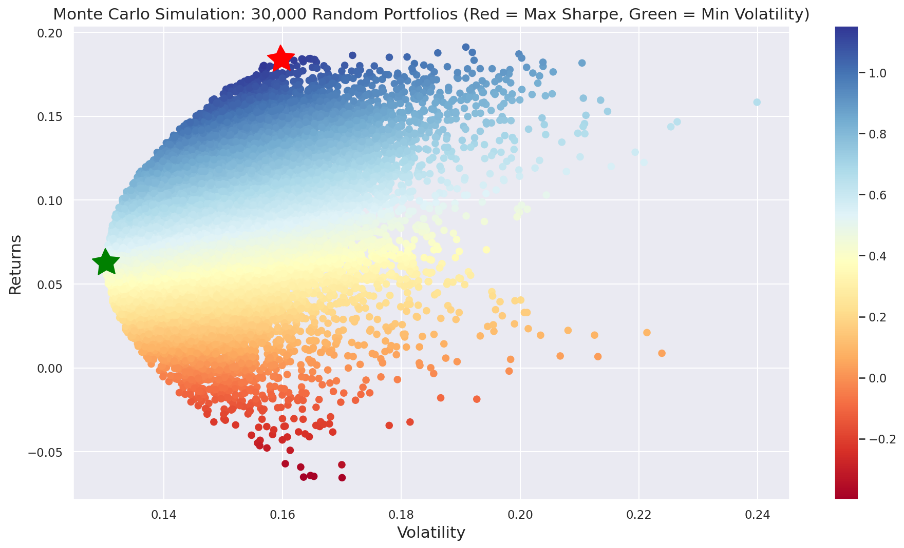

# Monte Carlo Portfolio Optimization

Applies Modern Portfolio Theory to 5 NSE stocks (Infosys, Sun Pharma, ITC, Coal India, SBI)
using 3 years of daily adjusted prices (Nov 2023 – Nov 2026) from Yahoo Finance. The notebook
generates 30,000 randomly weighted portfolios, computes annualized return, volatility, and
Sharpe ratio for each, and identifies the max-Sharpe and minimum-volatility portfolios.

## Results

| Portfolio | Return | Volatility | Sharpe |
|---|---|---|---|
| Equal weight (20% each) | 8.5% | 13.8% | 0.61 |
| **Max Sharpe** (55% Sun Pharma, 39% SBI) | **18.4%** | **16.0%** | **1.15** |
| Min volatility | 6.3% | 13.0% | 0.48 |

## Method
- Daily log returns and covariance matrix from adjusted closing prices
- 30,000 random weight allocations (seeded for reproducibility), annualized over 252 trading days
- Sharpe ratio = return / volatility (no risk-free rate); results are historical, not a forecast

## Tools
Python · pandas · NumPy · yfinance · Matplotlib · Seaborn

## Run it
You have to open the notebook in Google Colab and select **Runtime → Run all**. Data downloads automatically.
